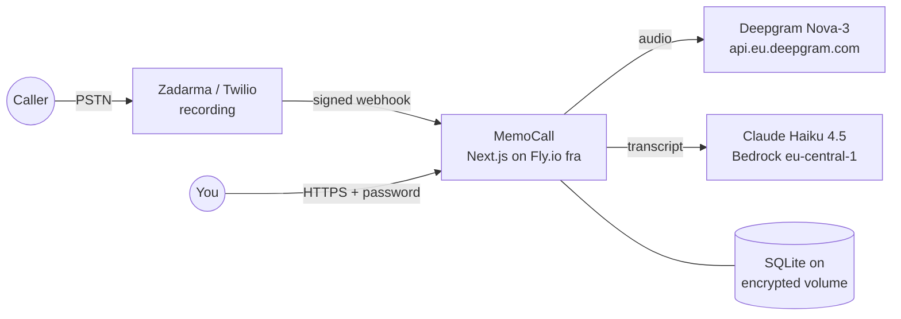

# MemoCall

**Turn your business phone calls into searchable notes, without sending a single byte outside the EU.**


MemoCall is a privacy-first, self-hosted call-notes assistant for a solo Polish-speaking
professional. You take or place a call as usual. When you hang up, the recording is
transcribed, summarised and classified, and it shows up in a private web panel: who called,
what was agreed, what to follow up on.

A recorded call flows **telephony (Zadarma, or Twilio as the retreat path) → Deepgram Nova-3
(EU STT) → Claude Haiku 4.5 on Amazon Bedrock (EU LLM) → a private TLS web panel**. Every
vendor runs under no-training and EU-residency terms. The app runs on Fly.io (Frankfurt) as
one small always-on Machine.

> **Single-user by design.** One installation = one user, one password. A colleague who
> wants MemoCall deploys their **own** instance (own phone number, own cloud accounts).
> The persona is *also the operator*, so there is no self-service sign-up.

## Features

- 📞 **Inbound and outbound capture.** Calls forwarded to your GSM are recorded, and the panel's
  `/call` page places click-to-call outbound calls.
- 🗣️ **Speaker-separated transcripts.** Stereo recordings keep the physical channel split, so
  "you" and "the caller" are never guessed.
- 🧠 **Structured analysis.** Summary, action items and classification from Claude Haiku 4.5
  (EU inference profile).
- 🔎 **Full-text search** over all conversations (SQLite FTS5), plus contacts, projects and tags.
- 🔁 **Durable post-call pipeline.** A claim → STT → analyze → classify job queue with retries
  and a dead-letter state, so a vendor outage delays a note instead of losing it.
- 🧪 **Runs fully offline on mocks.** Every provider has a `mock` implementation, so local dev
  needs no cloud accounts.

## Architecture



Each provider (`src/server/{stt,llm,telephony}/`) sits behind an interface. Adding a vendor
means a new file, an enum value in `src/env.js` and one branch in that directory's `index.ts`.

## Security and privacy model

- **Deny-by-default auth gate.** `src/proxy.ts` gates every route except the auth surface,
  static assets and the webhooks. tRPC procedures additionally enforce `protectedProcedure`.
- **Signatures are the webhook auth.** Telephony webhooks carry no session. They are verified
  against the vendor's signature computed over `PUBLIC_BASE_URL`, never the request host, and
  rejected with 403 on mismatch.
- **Hardened login.** bcrypt (cost 12), login throttling, an auth audit log, and a one-shot
  `/setup` wizard that atomically refuses to overwrite an existing password.
- **EU residency is enforced in code, not just documented.** Env validation and
  `scripts/onboard.mjs` reject non-EU regions, the Global Bedrock profile and US Deepgram hosts.
- **Data minimisation.** What the app stores about callers, and what it deliberately never
  stores, is documented in
  [`context/domain/04-privacy-and-anonymity.md`](context/domain/04-privacy-and-anonymity.md).
- **No secrets in the repo.** `.gitignore` and `.dockerignore` deny every `.env*` file except
  the `*.example` templates, as well as local databases and call recordings.

Found a vulnerability? See [SECURITY.md](SECURITY.md). Please don't open a public issue.

## Tech stack

Next.js 16 (App Router, standalone output) · React 19 · TypeScript · tRPC v11 + TanStack Query ·
Auth.js v5 · Drizzle ORM + libsql/SQLite · Tailwind CSS 4 · Biome · Vitest + Playwright ·
Docker on Fly.io.

---

The rest of this README is the **from-zero onboarding runbook**. The non-obvious constraints
live next to the code they guard: inline comments in `Dockerfile`, `src/env.js`, `src/proxy.ts`
and the provider directories.

---

## TL;DR paths

- **Just run it locally** (mock providers, no cloud accounts needed) → [Local development](#local-development). 5 minutes.
- **Deploy your own production instance** → [Production onboarding (0–9)](#production-onboarding-from-zero). Budget ~2–3 hours, mostly vendor-account setup.

---

## Three classes of work (read this first)

Onboarding is not one thing. It splits into three layers with three different cures:

| Class | What | Can a script help? | Cure |
| --- | --- | --- | --- |
| ☁️ **Vendor provisioning** | AWS IAM + Bedrock enablement, Twilio number + geo-permissions, Deepgram EU project | **No** — these live in vendor dashboards | This runbook's checklists |
| 🖥️ **Local + Fly ops** | clone, `npm ci`, app/volume create, secrets-in-order, webhook wiring, smoke test | **Yes** | `scripts/onboard.mjs` — validates the footguns, pre-flights each vendor (`--smoke`), and prints the ordered `fly secrets set` block |
| 🌐 **App setup** | set panel password, log in | Already trivial | The `/setup` wizard |

~60% of first-time friction is the ☁️ layer, which no wizard — web or terminal — can
remove. That is why this document exists.

---

## Prerequisites (step 0)

- **git**, **Node 20+**, and **npm 11** — the lockfile is generated with `npm@11.15.0`
  (see `packageManager` in `package.json`). ⚠️ **npm 10 fails `npm ci`** with
  `Missing: … from lock file`. Use `corepack enable` or install npm 11 explicitly.
- **Fly CLI** (only for deployment): `curl -L https://fly.io/install.sh | sh`, then
  `export PATH="$HOME/.fly/bin:$PATH"`, then `fly auth login`.

---

## Local development

The app boots fully on **mock** providers — no Twilio/AWS/Deepgram accounts required.

```bash
git clone <repo-url> && cd <repo-dir>
npm install                       # npm 11 — see Prerequisites
cp .env.example .env.local        # defaults are mock-mode + local sqlite
DATABASE_URL="file:./db.sqlite" node scripts/migrate.mjs   # same migrator prod runs at boot
# ⚠️ not `npm run db:push`: it cannot create the hand-written FTS5 search index
#    (drizzle/0005), and the first search then fails with `no such table`.
DATABASE_URL="file:./db.sqlite" PASSWORD="correct horse battery staple" \
  npx tsx scripts/dev-seed-auth.mjs   # seed your local panel password
npm run dev                       # http://localhost:3000
```

Then open http://localhost:3000 → you'll be routed to `/login` (password is the one you
seeded) or `/setup` (if you skipped the seed step). The `/call` page and the capture
pipeline work against the **mock** providers (canned Polish transcript + canned analysis).

Useful scripts:

| Command | Purpose |
| --- | --- |
| `npm run dev` | Next.js dev (Turbo), port 3000 |
| `npm run test` | Vitest single-run |
| `npm run typecheck` / `npm run check` | `tsc --noEmit` / Biome lint+format |
| `npm run db:studio` | Drizzle Studio |
| `scripts/dev-seed-conversations.mjs` | Seed sample conversations |

---

## Local with real Twilio (ngrok tunnel)

Telephony webhooks (`/api/telephony/voice`, `/api/telephony/recording-status`) are **inbound** —
Twilio's servers must POST to a public HTTPS URL. `localhost:3000` is unreachable from the
internet, so to drive the **real** end-to-end pipeline (real call → STT → LLM → panel) from
your machine you need a **public tunnel**. (Deepgram + Bedrock are *outbound* and work
without one — only the Twilio leg needs this; even outbound click-to-call needs it, because
the `recording-status` callback is inbound.)

### Steps

1. Start a tunnel — **cloudflared** (recommended) or ngrok:
   ```bash
   cloudflared tunnel --url http://localhost:3000   # no interstitial — Twilio-friendly
   # …or:  ngrok http 3000
   ```
   Copy the printed `https://…` URL (e.g. `https://abc123.trycloudflare.com`).

2. In `.env.local`, set the real secrets and point `PUBLIC_BASE_URL` at the tunnel:
   ```bash
   TELEPHONY_PROVIDER="twilio"
   TWILIO_ACCOUNT_SID="…"            TWILIO_AUTH_TOKEN="…"
   USER_FORWARD_NUMBER="+48…"        TWILIO_CALLER_ID="+48…"
   STT_PROVIDER="deepgram"           DEEPGRAM_API_KEY="…"     # EU-project key
   LLM_PROVIDER="anthropic-bedrock"  AWS_REGION="eu-central-1"  # + AWS keys + eu. model id
   PUBLIC_BASE_URL="https://abc123.trycloudflare.com"  # ⚠️ exact tunnel URL, https, no trailing slash
   ```
   Restart `npm run dev` so `~/env` re-reads the values.

3. Point the Twilio number's **Voice webhook** at `<tunnel>/api/telephony/voice`.

4. Call the number → the recording fires `recording-status` back through the tunnel → the
   pipeline runs and the analysis appears in the local panel.

### Gotchas

- ⚠️ **Signature must match `PUBLIC_BASE_URL`.** The webhook handler reconstructs the signed
  URL from `PUBLIC_BASE_URL + path` (never the request host) and **403s on mismatch**. If
  `PUBLIC_BASE_URL` ≠ the exact tunnel URL Twilio calls, every webhook is rejected. The
  `twilio` provider also refuses to start if `PUBLIC_BASE_URL` is unset.
- ⚠️ **ngrok-free shows an interstitial warning page** that Twilio won't click through — it can
  receive HTML instead of reaching your webhook. Prefer **cloudflared**, or ngrok with a
  reserved domain.
- ⚠️ **Free tunnel URLs change on every restart** → you must re-set `PUBLIC_BASE_URL` *and* the
  Twilio webhook each time. For repeated use, reserve a stable subdomain (cloudflared *named*
  tunnel or ngrok reserved domain).
- **EU residency still applies** — use the EU Deepgram project + `eu-central-1` Bedrock even locally.
- **Don't leave a dev tunnel up 24/7** — `npm run dev` is less hardened than the Fly standalone
  build; tear the tunnel down when you're done testing.

---

## Production onboarding (from zero)

> ⚠️ **Do NOT run `fly launch`** on this repo after initial setup. It regenerates
> `Dockerfile` and `fly.toml`, **silently clobbering** the 6 custom Dockerfile fixes and
> the `fly.toml` customizations (region, `NODE_OPTIONS`, `auto_stop_machines`). Use
> `fly deploy` only. If you somehow regenerate them, re-apply the fixes documented inline
> in `Dockerfile` (each one carries a comment explaining the failure it prevents).

### Step 1 — Get the code

```bash
git clone <repo-url> && cd <repo-dir>
npm install
```

### Step 2 — Provision vendor accounts (☁️ — the real wall)

These cannot be scripted from the repo. Do them in the vendor consoles. **EU residency is
a hard product constraint** — every region pin below is mandatory.

**Deepgram (STT)**
- Create a project **in the EU region**, generate an API key.
- ⚠️ A key from a **US** project returns HTTP 401 against `api.eu.deepgram.com` and the
  job dead-letters with `auth` — a *silent* loss of the note. The EU project is not optional.

**AWS Bedrock (LLM)**
- Enable **Claude Haiku 4.5** in **`eu-central-1`** (Bedrock → Model access).
- Create an IAM user with `bedrock:InvokeModel` on **both** the EU inference-profile ARN
  and the `anthropic.claude-haiku-4-5-…` foundation-model ARN.
- ⚠️ Use the **`eu.` inference profile**, never the Global profile (Global can route to
  the US). Use **Haiku** (not Sonnet — Sonnet's mandatory CBRN filter can hard-block).

**Telephony — pick ONE provider.** Twilio (US company, US1/IE1 regions) or Zadarma (Latvian
company, EU jurisdiction). `telephony-provider-zadarma` moved the project to Zadarma to close
the EU-residency constraint; the Twilio path stays wired as the documented retreat.

**Zadarma (telephony — current)**
- Buy a voice-capable number, enable the **PBX**, and create an internal extension (`100`).
- Route the DID **into the PBX**, then from the PBX to your GSM. Both links are separate and
  both must be set: SIP redirection (`destination=pbx`) *and* the PBX inbound scenario
  pointing at the extension. Neither is visible in any single API read — a half-configured
  chain answers "busy" with no error anywhere.
- Turn **recording ON** for that extension. Recording is a property of the **extension**, not
  of the call: with the PBX bypassed the phone rings and **nothing is recorded**.
- 🚫 **`speech_recognition = off` is a FORBIDDEN state.** With `off` the vendor stores
  mp3 / 8 kHz / **mono**; with `optional` or `all` it stores **Ogg/Opus / 48 kHz / stereo**.
  Only stereo carries the physical-channel speaker split the transcript depends on, and
  `optional` is free (it does not transcribe on its own). Flipping to `off` silently collapses
  every future conversation to a single speaker **with no error**.
- Set the account-level notification URL to `https://<your-app>.fly.dev/api/telephony/events`
  (Settings → Integrations and API → PBX call notifications). The URL is **per account, not
  per call** — one MemoCall instance = one Zadarma account. Saving it makes Zadarma issue a
  `GET ?zd_echo=<nonce>` handshake that the app must echo back verbatim; **if the save is
  rejected, the app is not reachable and nothing else will work.**

**Twilio (telephony — retreat path)**
- Buy a voice-capable number.
- Enable outbound to **+48 (Poland)**: Voice → Geographic Permissions (else `Calls.create`
  returns error 21210).
- Point the number's **Voice webhook** at `https://<your-app>.fly.dev/api/telephony/voice`.

### Step 3 — Create the Fly app + volume

```bash
fly apps create <your-app-name>
fly volumes create data --size 3 --region fra   # encrypted; /data holds the sqlite db
```

⚠️ **Edit `fly.toml` first:** it ships with `app = 'CHANGE-ME-memo-call'` on purpose, so a
deploy without your own app name fails loudly instead of targeting someone else's app.
Replace it with `<your-app-name>`.

`fly.toml` is otherwise preconfigured for `fra` (Frankfurt), 512MB always-on Machine, TLS-forced. Don't regenerate it (see warning above).

### Step 4 — Set the boot-critical secrets

> 💡 **Shortcut for Steps 4 + 6 — `scripts/onboard.mjs`.** Instead of hand-typing the ~8
> `fly secrets set` commands across these two steps, copy `.env.onboard.example` →
> `.env.onboard.local` (auto-gitignored), fill it, and run `node scripts/onboard.mjs --smoke`.
> It **validates every value before anything is set** (EU region, `eu.` model id, `AUTH_SECRET`
> ≥32, `AUTH_URL` with no trailing slash, E.164 numbers, EU Deepgram host), **pre-flights each
> vendor** (✅/❌ — catches the Deepgram US-key / Bedrock enablement / Twilio +48 footguns), and
> prints the exact commands **in the correct order**. It never runs `fly` — you paste the block
> yourself. Drop `--smoke` to skip the network pre-flight.

```bash
fly secrets set DATABASE_URL="file:/data/db.sqlite"
# ⚠️ Generate into a variable and CHECK THE LENGTH. `fly secrets set VAR="$(cmd)"`
# sets an EMPTY secret without complaint when cmd is missing, and an empty
# AUTH_SECRET fails env validation at boot → crash-loop (happened 2026-09-07).
SECRET=$(node -e 'console.log(require("crypto").randomBytes(32).toString("hex"))')
echo "${#SECRET}"                                          # MUST print 64
fly secrets set AUTH_SECRET="$SECRET"
fly secrets set AUTH_URL="https://<your-app>.fly.dev"      # ⚠️ no trailing slash; else sign-out breaks
```

> ⚠️ **Re-set `AUTH_URL` if the Machine is ever recreated**, or sign-out silently regresses
> to redirecting at `https://0.0.0.0:3000/login`.

### Step 5 — First deploy (schema migrates on boot)

```bash
fly deploy
```

The Docker entrypoint runs `node scripts/migrate.mjs` on Machine boot **before** the
server starts; a failed migration fails the boot and Fly rolls back. The first migration
also seeds the single user row (`'me'`).

### Step 6 — Wire the real providers

⚠️ **Deploy-order gotcha (applies to every `*_PROVIDER` switch below):** the image you
just deployed already contains all enum values, so it's safe to set these now. But if you
ever change provider code, **`fly deploy` the image that has the new enum value BEFORE
setting the matching `*_PROVIDER` secret** — setting the secret first restarts the *old*
image, which crashes at boot on env validation.

> 💡 `node scripts/onboard.mjs` (the Step 4 shortcut) also generates this provider block in
> the correct order — each `*_PROVIDER` flip emitted as a separate command after its creds.

```bash
# STT — Deepgram (EU)
fly secrets set DEEPGRAM_API_KEY="<eu-project-key>" STT_PROVIDER="deepgram"

# LLM — Bedrock (EU) — set the four AWS vars first, then flip the provider
fly secrets set AWS_ACCESS_KEY_ID="<id>" AWS_SECRET_ACCESS_KEY="<key>" \
  AWS_REGION="eu-central-1" BEDROCK_MODEL_ID="eu.anthropic.claude-haiku-4-5-20251001-v1:0"
fly secrets set LLM_PROVIDER="anthropic-bedrock"

# Telephony — Zadarma (current) — creds first, provider flip LAST
fly secrets set ZADARMA_USER_KEY="<user-key>" ZADARMA_SECRET="<secret>" \
  ZADARMA_SIP_EXTENSION="100" USER_FORWARD_NUMBER="<your-+E164-gsm>" \
  PUBLIC_BASE_URL="https://<your-app>.fly.dev"
fly secrets set TELEPHONY_PROVIDER="zadarma"

# Telephony — Twilio (retreat path; use INSTEAD of the Zadarma block above)
fly secrets set TWILIO_ACCOUNT_SID="<sid>" TWILIO_AUTH_TOKEN="<token>" \
  USER_FORWARD_NUMBER="<your-+E164-gsm>" TWILIO_CALLER_ID="<your-+E164-did>" \
  PUBLIC_BASE_URL="https://<your-app>.fly.dev" TELEPHONY_PROVIDER="twilio"
```

⚠️ **`ZADARMA_SIP_EXTENSION` is the BARE extension number** (`100`) — not the SIP login
(`123456-100`) and not the PBX id (`123456`). A wrong value returns **no error**: the outbound
call is placed and simply is not recorded.

⚠️ **Order matters within the Zadarma block.** `TELEPHONY_PROVIDER` is boot-gating, and the
Zadarma provider validates `ZADARMA_USER_KEY` / `ZADARMA_SECRET` at construction — flipping the
provider before its credentials exist crash-loops the Machine. Also register the notification
URL in the Zadarma panel (Step 2) **before** the flip, so the first live webhook has somewhere
to land.

Each `fly secrets set` restarts the Machine (~5–10s). The providers validate their
credentials at construction and **fail loud** at boot if anything is missing or wrong —
watch `fly logs` after each flip.

### Step 7 — Verify (smoke)

```bash
fly status                 # Machine up, latest version, region fra
fly logs --no-tail         # look for provider auth errors after the flips
curl -I https://<your-app>.fly.dev   # expect a redirect to /setup or /login (TLS-only)
```

### Step 8 — App setup (🌐, ~2 min)

Open `https://<your-app>.fly.dev` → you'll land on **`/setup`** (because no password is
set). Choose a password: **12+ characters OR a 4+-word passphrase** (e.g.
`correct horse battery staple` — easier to type on mobile). Submit → you're routed to
`/login`. Log in → the panel.

### Step 9 — First call

Call your number (or use the panel's `/call` page for outbound click-to-call). After
you hang up, the recording flows telephony → Deepgram EU → Bedrock EU and the transcript +
structured analysis appear in the panel on the next page load (post-call, not realtime).

---

## Operations cheat-sheet

```bash
fly logs --follow                 # live tail
fly secrets list                  # names only
fly releases                      # deploy history
fly releases rollback <ver>       # revert
fly ssh console                   # shell into the Machine
```

> ⚠️ For anything touching `/data`, pass `--machine <id>` (from `fly machine list`). A bare
> `fly ssh console` can land in an ephemeral machine without the volume — a read then fails
> loudly, but a write appears to succeed against a machine that is discarded moments later.

**Reset the panel password** (operator-only; there is no in-app rotation). The `sqlite3` CLI
is **not** in the image, so use the bundled `@libsql/client`, and run it **from `/app`** so
the import resolves:

```bash
fly ssh console --machine <id>
cd /app
node -e 'import("@libsql/client").then(async m=>{const c=m.createClient({url:"file:/data/db.sqlite"});await c.execute({sql:`UPDATE "memo-call_auth_config" SET password_hash = NULL WHERE user_id = ?`,args:["me"]});console.log("reset ok");c.close();})'
```

Then open the panel **logged out** (incognito): with no password set, the next visit
re-enters `/setup`. A browser that still holds a valid session is let through instead.

---

## Project layout

- **`src/server/{stt,llm,telephony}/`** — provider interfaces + implementations. Adding a
  vendor is a new file, an enum value in `src/env.js` and a branch in that directory's
  `index.ts` — nothing outside it changes.
- **`src/server/jobs/`** — the durable post-call pipeline (claim → STT → analyze → classify).
- **`src/server/api/routers/`** — tRPC routers behind the panel.
- **`drizzle/`** — migrations, applied on Machine boot by `scripts/migrate.mjs`.
- **`scripts/onboard.mjs`** — the onboarding helper from Step 4.
- **`context/domain/04-privacy-and-anonymity.md`** — the privacy model.

---

## License

[MIT](LICENSE) © 2026 Konrad Lis

<sub>Scaffolded with [Create T3 App](https://create.t3.gg/) — Next.js 16, tRPC v11,
Drizzle, libsql/SQLite, Tailwind 4, Biome.</sub>
